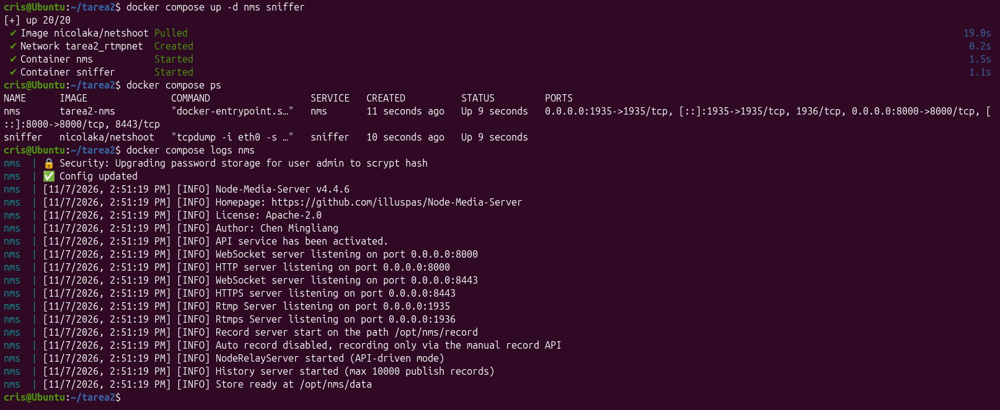
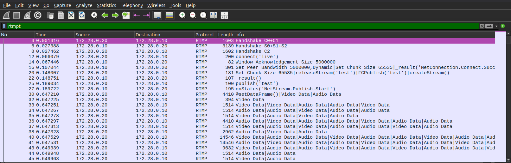
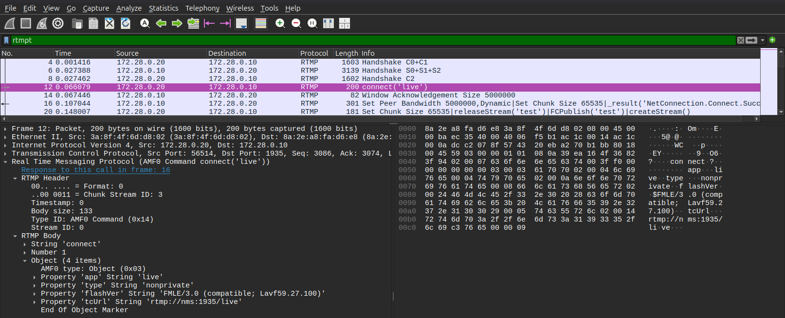
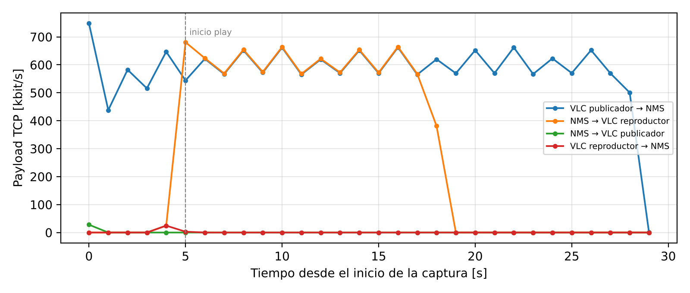
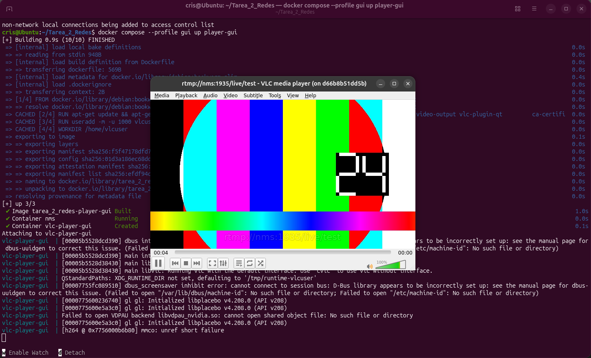
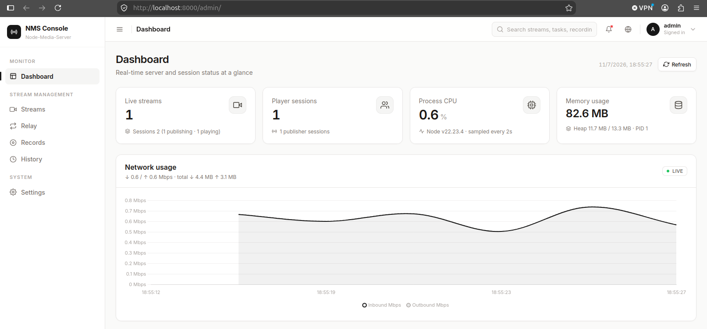

# Tarea 2 — Taller de Redes: Protocolo RTMP
> Despliegue en contenedores Docker de un servidor RTMP (Node-Media-Server) y clientes VLC que publican y reproducen video, con captura y análisis del tráfico generado.
> Video de la entrega: _(pegar aquí el enlace, ≤ 8 min)_

## Tabla de contenidos
* [Información general](#información-general)
* [Tecnologías utilizadas](#tecnologías-utilizadas)
* [Funcionalidades](#funcionalidades)
* [Capturas de pantalla](#capturas-de-pantalla)
* [Instalación](#instalación)
* [Uso](#uso)
* [Estado del proyecto](#estado-del-proyecto)
* [Mejoras pendientes](#mejoras-pendientes)
* [Agradecimientos](#agradecimientos)
* [Contacto](#contacto)


## Información general
- Trabajo individual (grupo 14 de la asignación de protocolos) del curso Taller de Redes y Servicios (UDP, 2026-2). El protocolo asignado es **RTMP** (_Real-Time Messaging Protocol_).
- El objetivo es instalar una dupla servidor–cliente que use RTMP, ponerla a comunicarse y estudiar el tráfico que genera: el handshake, los comandos AMF0, los mensajes de control y el flujo de audio y video.
- Toda la experiencia corre en contenedores para que se pueda repetir en cualquier equipo con un solo `docker compose`.
- Este repositorio es la base de la Tarea 3, donde se modificará el tráfico en tránsito y se medirán sus efectos.

Dupla asignada:

| Rol | Software | Repositorio |
|---|---|---|
| Servidor | Node-Media-Server v4.4.6 | https://github.com/illuspas/Node-Media-Server |
| Cliente (publicador y reproductor) | VLC 3.0.x | https://github.com/videolan/vlc |

Arquitectura (red bridge `rtmpnet`, 172.28.0.0/24):

```
 vlc-publisher (172.28.0.20) --RTMP publish--> nms (172.28.0.10:1935) --RTMP play--> vlc-player (172.28.0.30)
                                                  ^
                                         sniffer (tcpdump, misma interfaz que nms)
```


## Tecnologías utilizadas
- Docker Engine 29.9.3 y Docker Compose v5.7.0
- Node.js 22 (imagen `node:22-alpine`)
- Node-Media-Server 4.4.6
- VLC 3.0 (imagen `debian:bookworm-slim`)
- tcpdump (imagen `nicolaka/netshoot`)
- Wireshark / tshark 4.6.4
- FFmpeg (solo para generar el video de prueba)
- Typst (informe)


## Funcionalidades
- Servidor RTMP en el puerto 1935, con panel web y API en el puerto 8000.
- VLC como **publicador**: remultiplexa un MP4 (H.264 + AAC) a FLV y lo envía por RTMP, sin recodificar.
- VLC como **reproductor**, con ventana (`player-gui`) o sin ella (`player`, útil para capturas repetibles).
- **Sniffer** que comparte la interfaz del servidor y guarda todo el tráfico RTMP en `captures/rtmp_docker.pcap`.
- Script `scripts/analizar_rtmp.sh` que resume una captura con tshark: conversaciones, mensajes de control, tipos de cabecera de chunk, keyframes y cierres.


## Capturas de pantalla
Arranque de los contenedores y log del servidor:


Inicio de la sesión de publicación en Wireshark (filtro `rtmpt`):


Comando `connect('live')` desplegado:


Carga útil TCP por segundo en cada sentido:


VLC en contenedor reproduciendo el flujo:


Panel web de Node-Media-Server con el flujo activo:



## Instalación
Requisitos:
- Ubuntu (probado en Ubuntu 26.04.1 LTS en máquina virtual), con 4 GB de RAM y 2 CPU como mínimo.
- Docker Engine con el plugin `docker compose`.
- Wireshark/tshark, git y, opcionalmente, ffmpeg.

```bash
# Herramientas
sudo apt update
sudo apt install -y wireshark tshark ffmpeg git x11-xserver-utils

# Docker: seguir https://docs.docker.com/engine/install/ubuntu/ y luego
sudo usermod -aG docker $USER      # cerrar sesión y volver a entrar

# Proyecto
git clone https://github.com/csanmartin12/Tarea_2_Redes.git
cd Tarea_2_Redes
chmod +x scripts/*.sh
docker compose build
```

Opcional: generar un video de prueba de 3 minutos (el incluido dura 30 s).

```bash
ffmpeg -y -f lavfi -i testsrc=size=640x360:rate=25 -f lavfi -i sine=frequency=440:sample_rate=44100 \
  -t 180 -pix_fmt yuv420p -c:v libx264 -preset veryfast -g 50 -b:v 600k -c:a aac -b:a 96k media/muestra.mp4
```


## Uso
**1. Levantar el servidor y la captura**
```bash
docker compose up -d nms sniffer
docker compose logs nms        # "Rtmp Server listening on port 0.0.0.0:1935"
```

**2. Publicar el video con VLC** (otra terminal)
```bash
docker compose up publisher
```

**3. Reproducir con VLC** (otra terminal, mientras se publica)
```bash
xhost +local:
docker compose --profile gui up player-gui        # con ventana
# o bien
docker compose --profile headless up player       # sin ventana
```
También funciona desde el VLC del host: *Medio → Abrir ubicación de red →* `rtmp://localhost:1935/live/test`.

**4. Panel web**

Abrir http://localhost:8000/admin (usuario `admin`, contraseña `admin`) y ver la sección *Streams*.

**5. Detener y analizar**
```bash
docker compose logs nms > captures/nms.log
docker compose --profile gui --profile headless down
sudo chown -R $USER:$USER captures
./scripts/analizar_rtmp.sh captures/rtmp_docker.pcap
wireshark captures/rtmp_docker.pcap
```

> **Importante para Wireshark:** el filtro de visualización es `rtmpt` (con t); `rtmp` es otro protocolo (AppleTalk) y no muestra nada. En Wireshark 4.2 o anterior, además, hay que subir *Edit → Preferences → Protocols → RTMPT → Maximum packet size* a `2000000`, porque Node-Media-Server usa un _chunk size_ de 65535 bytes y el disector descarta mensajes mayores a 32768 (aparecen como *Malformed*). En la versión 4.6 esa opción ya no existe ni hace falta.

Estructura del repositorio:
```
docker-compose.yml     servidor, publicador, reproductor y sniffer
server/                Dockerfile + config.json de Node-Media-Server
vlc/                   Dockerfile de VLC (publicador y reproductor)
media/muestra.mp4      video de prueba (H.264 640x360 25 fps + AAC 44.1 kHz)
scripts/               analizar_rtmp.sh, prueba_nativa.sh (sin Docker)
captures/              capturas .pcap y resúmenes
informe/               informe en Typst (main.typ) e imágenes
```


## Estado del proyecto
Proyecto: _en progreso_. Completos los capítulos 1 (Introducción al protocolo) y 2 (Análisis de tráfico), entregados en la Tarea 2. El capítulo 3 (Modificación de tráfico y análisis de métricas) se desarrollará en la Tarea 3.


## Mejoras pendientes
Mejoras:
- Publicar en bucle para tener una transmisión continua.
- Probar RTMPS (puerto 1936) y comparar con RTMP sin cifrar.

Pendiente (Tarea 3):
- Interceptar y modificar campos RTMP en tránsito (_chunk size_, _type id_, timestamps, comandos AMF0).
- Medir latencia, throughput y pérdida bajo distintas condiciones de red (`tc netem`).


## Agradecimientos
- Plantilla del README basada en [README-cheatsheet](https://github.com/ritaly/README-cheatsheet) de ritaly.
- Especificación _Adobe's Real Time Messaging Protocol_ v1.0 (2012).
- Documentación de [Node-Media-Server](https://github.com/illuspas/Node-Media-Server) y [VLC](https://github.com/videolan/vlc).


## Contacto
Creado por Cristian San Martín ([@csanmartin12](https://github.com/csanmartin12)).
